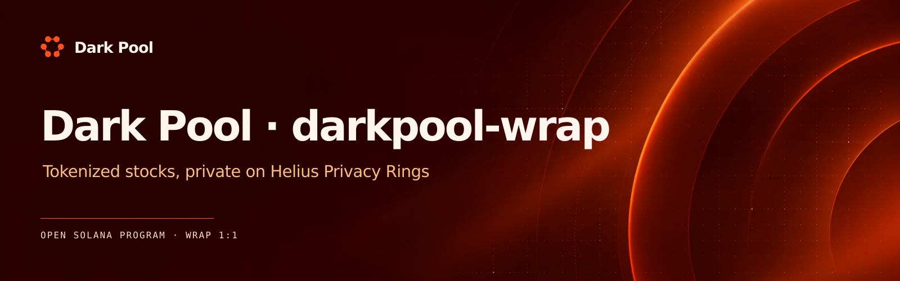
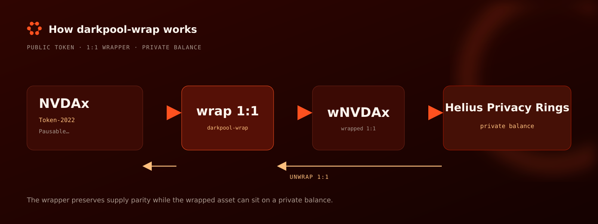
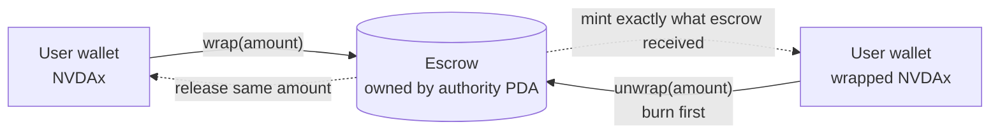

<p align="center"></p>

<h1 align="center">darkpool-wrap</h1>

<p align="center">
  <b>Minimal 1:1 Token-2022 wrapper for Solana.</b><br/>
  Turns tokenized stocks and other extension-heavy mints into a plain Token-2022 mint that privacy pools can hold.
</p>

<p align="center">
  <a href="https://verify.osec.io/status/4WMGnz33sRKHynF2an3kWmfZtd8eudTVCExtSmMWuaCc"></a>
  <a href="https://solscan.io/account/4WMGnz33sRKHynF2an3kWmfZtd8eudTVCExtSmMWuaCc"></a>
  <a href="LICENSE"></a>
  <a href="https://github.com/sipLinchik/darkpool-wrap/actions/workflows/ci.yml"></a>
  
</p>

---

## What it is

Tokenized stocks on Solana (xStocks such as NVDAx) are Token-2022 mints with permanent delegate,
pausable, default account state, scaled UI amount and transfer hook extensions. Privacy pools like
[Helius Privacy Rings](https://www.helius.dev/) can't hold mints like that directly.

`darkpool-wrap` locks the original token in an escrow and mints the same amount of a plain Token-2022
token that has only `MetadataPointer` and `TokenMetadata`. Unwrapping burns that token and releases the
original. It holds no keys, has no admin instructions and has three instructions in about 400 lines of
[pinocchio](https://github.com/anza-xyz/pinocchio). It powers [Dark Pool](https://darkpoolrings.xyz).

## How it works

<p align="center"></p>

<details>
<summary>Escrow flow (text diagram)</summary>



</details>

1. **Create.** Anyone calls `create_wrapped_mint` once per source mint. The wrapped mint is a PDA, and its decimals, freeze authority and metadata are copied on-chain from the source mint.
2. **Wrap.** The user transfers `amount` of the source token into the escrow. The program measures how much the escrow actually received and mints exactly that much wrapped token.
3. **Use.** The wrapped token is a plain Token-2022 token that can be deposited into Privacy Rings, swapped or transferred like any other token.
4. **Unwrap.** The program burns `amount` wrapped tokens from the holder, then transfers the same `amount` of the source token out of the escrow.

## Deployment

| | |
|---|---|
| **Program ID** | [`4WMGnz33sRKHynF2an3kWmfZtd8eudTVCExtSmMWuaCc`](https://solscan.io/account/4WMGnz33sRKHynF2an3kWmfZtd8eudTVCExtSmMWuaCc) · [Explorer](https://explorer.solana.com/address/4WMGnz33sRKHynF2an3kWmfZtd8eudTVCExtSmMWuaCc) |
| **Network** | Solana mainnet-beta |
| **Loader** | BPF Upgradeable Loader, ProgramData [`3VG2zmtjWVNCDHkcD5d8MCKSFSXatxJmF4jsD3k8uXA1`](https://solscan.io/account/3VG2zmtjWVNCDHkcD5d8MCKSFSXatxJmF4jsD3k8uXA1) |
| **Upgrade authority** | Squads v4 multisig, **2 of 3**: vault (index 0) [`8xwvi4KwQeRzXqVPpMh7aF3bvZ2S6kqSX8f9gZXnNiPq`](https://solscan.io/account/8xwvi4KwQeRzXqVPpMh7aF3bvZ2S6kqSX8f9gZXnNiPq) of multisig [`C8w27YNYvbqRHVBdbs9ZiTDWyRt9XwqJ3qHCZpCaBNe9`](https://solscan.io/account/C8w27YNYvbqRHVBdbs9ZiTDWyRt9XwqJ3qHCZpCaBNe9). Members: owner `2yv73QNUFz8JHqRkj4Lay4LQHxKZ4Wm6E9pSz5dCdZhX`, ops `H45QBYAWphG5ARjJXJ6GPWN45DVV1NaRKrKfKZ1DnP83`, backup `5YeWCogoKHkkLdfxjAeRzozXsLwpwZijt2sga8DoBJ5q`. Handover tx [`3c8W85py…`](https://solscan.io/tx/3c8W85pyen2aKTKNg6FzNcdTLLaXYN4bm5rQxdWNaEojCEvvSptHKqiYYG4dxw3555JbSRPvHiZAq8qhAt7pw7Sj) |
| **Verified build** | [verify.osec.io](https://verify.osec.io/status/4WMGnz33sRKHynF2an3kWmfZtd8eudTVCExtSmMWuaCc) |
| **Executable hash** | `ac59d863472d93dd7e251f680d6417b3d21018dedef69971651181a6c982a8bc` |

Always check the current upgrade authority on-chain (`solana program show 4WMGnz33sRKHynF2an3kWmfZtd8eudTVCExtSmMWuaCc`).
This table can go out of date.

## Addresses

| Account | Derivation |
|---|---|
| Wrapped mint | PDA `["mint", unwrapped_mint, token_2022_program_id]` |
| Mint authority | PDA `["authority", wrapped_mint]` |
| Escrow | any token account of the unwrapped mint whose owner is the authority PDA. Clients use its associated token account. |

The seeds and account order match [SPL token-wrap](https://github.com/solana-program/token-wrap), so tooling
written for it needs only a different program ID.

## Instructions

All amounts are raw `u64` little-endian. Instruction data is a 1-byte tag followed by arguments.

### `0` · `create_wrapped_mint`

Data: `[0]`

| # | Account | Flags | Notes |
|---|---|---|---|
| 0 | payer | signer, writable | pays rent for the wrapped mint |
| 1 | wrapped mint | writable | must equal the mint PDA |
| 2 | authority | | must equal the authority PDA |
| 3 | unwrapped mint | | owned by SPL Token or Token-2022 |
| 4 | System program | | |
| 5 | Token-2022 program | | |

Invariants:
- One wrapped mint per `(unwrapped_mint, token_2022)`. A second call fails with `AlreadyCreated`.
- Lamports that someone sent to the PDA in advance don't block creation.
- Decimals and freeze authority are copied from the unwrapped mint. Mint authority is the authority PDA.
- If the unwrapped mint has in-mint `TokenMetadata`, its name, symbol and URI are copied on-chain. The caller
  can't supply metadata, so nobody can claim a PDA with a fake name. The update authority is the authority PDA,
  and the program has no instruction that updates metadata, so the metadata can't be changed.
- The wrapped mint has only `MetadataPointer` (pointing to itself) and, when the source has metadata, `TokenMetadata`.

### `1` · `wrap(amount)`

Data: `[1, amount: u64]`

| # | Account | Flags |
|---|---|---|
| 0 | recipient wrapped token account | writable |
| 1 | wrapped mint | writable |
| 2 | authority PDA | |
| 3 | unwrapped token program (SPL Token or Token-2022) | |
| 4 | Token-2022 program | |
| 5 | source unwrapped token account | writable |
| 6 | unwrapped mint | |
| 7 | escrow | writable |
| 8 | owner or delegate of the source account | signer |
| 9.. | extra accounts forwarded to `transfer_checked` (transfer hook) | |

Invariants:
- The escrow must be a token account of the unwrapped mint whose owner is the authority PDA (`BadEscrow` otherwise).
- The program mints `escrow_after - escrow_before`, not `amount`. A transfer fee on the source mint therefore can't create unbacked wrapped tokens.
- A zero amount, or a transfer that leaves the escrow balance unchanged, fails with `ZeroAmount`.

### `2` · `unwrap(amount)`

Data: `[2, amount: u64]`

| # | Account | Flags |
|---|---|---|
| 0 | escrow | writable |
| 1 | recipient unwrapped token account | writable |
| 2 | authority PDA | |
| 3 | unwrapped mint | |
| 4 | Token-2022 program | |
| 5 | unwrapped token program | |
| 6 | source wrapped token account | writable |
| 7 | wrapped mint | writable |
| 8 | owner or delegate of the source wrapped account | signer |
| 9.. | extra accounts forwarded to `transfer_checked` (transfer hook) | |

Invariants:
- The program burns first. Token-2022 checks the signer and the balance, so nobody can unwrap tokens they don't hold.
- Then the authority PDA transfers the same `amount` from the escrow. The escrow and wrapped supply go down by the same amount.
- The wrapped mint must be the PDA for the given unwrapped mint, so a fake mint can't drain the escrow.

### Errors

| Code | Name | Meaning |
|---|---|---|
| `0x1` | `WrappedMintMismatch` | wrapped mint is not the PDA for this unwrapped mint |
| `0x2` | `AuthorityMismatch` | authority is not the PDA for this wrapped mint |
| `0x3` | `BadTokenProgram` | wrong token program, or the program doesn't own the mint |
| `0x4` | `BadEscrow` | escrow is not a token account of the mint owned by the authority PDA |
| `0x5` | `ZeroAmount` | zero amount, or nothing arrived in the escrow |
| `0x6` | `AlreadyCreated` | wrapped mint already exists |
| `0x7` | `BadMint` | unwrapped mint is uninitialized or has oversized metadata |

## Security model

**1:1 escrow.** For every wrapped mint, the tokens held by escrows owned by its authority PDA are never less than
the wrapped supply. `wrap` mints only what the escrow received, and `unwrap` burns before it releases anything.
No instruction mints wrapped tokens or moves escrowed tokens any other way. The one exception is outside the
program: a permanent delegate on the source mint (see below).

**No admin.** The program stores no configuration and has no privileged instructions. After creation, nothing
can change a wrapped mint's authorities, metadata or extensions.

**The issuer keeps its powers.** Wrapping doesn't remove anything the source mint's authorities can already do.
For xStocks and similar mints that means:

| Issuer power (source mint) | Effect on wrapped holders |
|---|---|
| **Freeze authority** | copied to the wrapped mint, so the issuer can freeze wrapped token accounts as well as source accounts |
| **Permanent delegate** | can move tokens out of the escrow. Wrapped tokens would then be backed by less than 1:1 |
| **Pausable** | while the source mint is paused, `wrap` and `unwrap` fail because the transfer into or out of the escrow fails |
| **Transfer hook** | runs on every wrap and unwrap. Its extra accounts must be passed after the fixed account list |
| **Default account state** | a frozen default can block the escrow until the issuer thaws it |
| **Transfer fee** | charged on the way in and the way out. The wrapper mints only what arrived, so the peg holds |

**Upgradeable.** The program can be upgraded by the authority in the [Deployment](#deployment) table. Use the
verified build to check that the deployed code matches this repository.

**Unaudited.** This code has not been audited by a third party. It is covered by the test suite below and by
review against SPL token-wrap. Use at your own risk. To report a vulnerability, see [SECURITY.md](SECURITY.md).

**Not included:** multisig signers, metadata sync, Metaplex metadata, closing escrows.

## Reproducible build

The deployed binary is built in the pinned Solana Foundation image. The crate doesn't depend on `solana-program`,
so the image has to be passed explicitly:

```bash
cargo install solana-verify --locked --version 0.5.2   # needs Docker

solana-verify build --base-image solanafoundation/solana-verifiable-build:4.3.0
solana-verify get-executable-hash target/deploy/darkpool_wrap.so
# ac59d863472d93dd7e251f680d6417b3d21018dedef69971651181a6c982a8bc

solana-verify -u mainnet-beta get-program-hash 4WMGnz33sRKHynF2an3kWmfZtd8eudTVCExtSmMWuaCc
# ac59d863472d93dd7e251f680d6417b3d21018dedef69971651181a6c982a8bc
```

Verify straight from this repository, locally or via the OtterSec remote builder:

```bash
solana-verify verify-from-repo -u mainnet-beta \
  --program-id 4WMGnz33sRKHynF2an3kWmfZtd8eudTVCExtSmMWuaCc \
  --base-image solanafoundation/solana-verifiable-build:4.3.0 \
  --library-name darkpool_wrap \
  https://github.com/sipLinchik/darkpool-wrap

# remote job, result shown on verify.osec.io
solana-verify verify-from-repo --remote -u mainnet-beta ...same flags...
```

## Tests

44 checks run against a local `solana-test-validator` with the built `.so` loaded. They cover three source mints:

- an xStock-shaped Token-2022 mint with every extension listed above and a freeze authority, whose wrapped-mint PDA was funded in advance by an attacker;
- a Token-2022 mint with a 1% transfer fee and no freeze authority;
- a classic SPL Token mint without metadata.

For each mint the suite checks creation (extensions, decimals, freeze authority, mint authority, metadata, second
create rejected), the 1:1 peg through wrap and unwrap, and rejection of: unwrapping more than held, a zero amount,
an escrow owned by the user, unwrapping by someone who isn't the owner, a fake wrapped mint, and a wrong authority PDA.

```bash
cargo build-sbf                 # Solana CLI (Agave); CI uses 4.4.1
cd tests && npm ci && npm test  # starts a throwaway validator, prints "44 passed, 0 failed"
```

CI runs the same suite on every push ([workflow](.github/workflows/ci.yml)).

## License

[Apache-2.0](LICENSE), the same license as upstream [SPL token-wrap](https://github.com/solana-program/token-wrap).

<p align="center"><a href="https://darkpoolrings.xyz">darkpoolrings.xyz</a></p>
